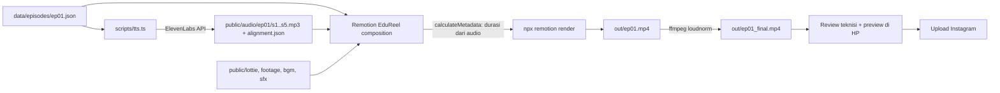

# Doktermobil Reels Edukasi: Production Plan (Remotion + Claude Code)

Series educational Reels 15 to 30 detik untuk pengendara mobil, dibangun sebagai **satu template Remotion yang data driven**: tiap episode cukup satu file JSON, voice over di-generate otomatis, lalu render ke MP4.

---

## 1. Strategy

### Kenapa template, bukan edit per video
Kalau tiap video diedit manual, episode ke 10 sama capeknya dengan episode 1. Dengan template:
* Episode baru = tulis JSON (script + teks layar) lalu jalankan 2 command.
* Konsistensi brand otomatis (font, warna, posisi caption, safe zone).
* Durasi scene mengikuti panjang voice over, jadi tidak ada sync manual.

Estimasi: template pertama 1 sampai 2 hari kerja, episode berikutnya sekitar 30 menit (termasuk review teknisi).

### Series concept: "MITOS ATAU FAKTA?" by Doktermobil
Format myth busting cocok untuk Reels karena hook-nya alami (orang merasa "eh, saya juga gitu"), memancing komentar, dan bisa di-save.

Struktur tetap 5 beat:

| Beat | Fungsi | Durasi |
|---|---|---|
| 1. Hook | Hentikan scroll di 1 sampai 2 detik pertama | 2 s/d 3 dtk |
| 2. Mitos | Sebut kebiasaan yang salah | 3 s/d 4 dtk |
| 3. Fakta | Jawaban benar, angka konkret | 6 s/d 8 dtk |
| 4. Kenapa / Tips | 2 sampai 3 poin singkat dengan ikon | 5 s/d 7 dtk |
| 5. CTA | Save, follow, atau booking servis | 3 s/d 4 dtk |

### Visual direction
* **Brand:** merah `#E31E24`, hitam `#0B0B0B`, putih `#FFFFFF`. Headline pakai **Anton**, body dan caption pakai **Poppins** (sama dengan design system thumbnail YouTube).
* **Background:** footage asli bengkel Doktermobil (shoot vertikal 9:16, 4 sampai 8 detik per clip) yang di-dim dan di-blur sedikit. Real footage jauh lebih kredibel daripada ilustrasi generik. Kalau belum ada footage, pakai dark gradient + grain halus.
* **Overlay:** Lottie untuk ikon (mesin, termometer, aki, ban, AC), stamp "MITOS" (merah, efek cap miring) dan "FAKTA" (putih dengan check).
* **Caption:** word by word, kata kunci di-highlight merah. Wajib burned in karena sebagian besar orang nonton Reels tanpa suara.
* **Optional hero 3D:** model mobil `.glb` dari Blender via `@remotion/three` untuk intro atau CTA. Jangan di episode pertama; kerjakan setelah template stabil.

---

## 2. Instagram Reels specs

| Item | Value |
|---|---|
| Resolusi | 1080 x 1920 (9:16) |
| FPS | 30 |
| Durasi | 15 s/d 30 detik (sweet spot 20 s/d 25) |
| Codec | H.264 video, AAC audio 192 kbps |
| Loudness final | sekitar -14 LUFS integrated, true peak -1.5 dB |
| Safe zone (perkiraan) | hindari 250 px atas, 420 px bawah, 160 px kanan (UI Instagram) |
| Cover | frame pertama harus layak jadi cover (teks hook besar) |
| Loop | frame terakhir secara visual mirip frame awal supaya replay terasa mulus |

Safe zone di atas adalah perkiraan. Verifikasi dengan upload draft private lalu screenshot di HP.

---

## 3. Episode lineup (batch 1)

Semua klaim teknis **wajib direview teknisi Doktermobil** sebelum publish. Ini konten edukasi atas nama brand bengkel; satu fakta salah bisa merusak kredibilitas.

| # | Judul / Hook | Mitos | Fakta (draft, perlu review teknisi) | CTA |
|---|---|---|---|---|
| 01 | "STOP manasin mobil 15 menit!" | Mesin harus dipanaskan lama tiap pagi | Mobil injeksi cukup idle 30 s/d 60 detik lalu jalan pelan | Follow untuk tips |
| 02 | "AC bau apek? Bukan freon habis!" | Bau apek = freon habis | Umumnya filter kabin atau evaporator kotor | Servis AC di Doktermobil |
| 03 | "Angka di ban itu BUKAN tekanan yang benar" | Isi angin sesuai tulisan di dinding ban | Itu tekanan maksimal; angka benar ada di stiker pilar pintu pengemudi atau buku manual, cek saat ban dingin | Save video ini |
| 04 | "Lampu dashboard nyala? Lihat warnanya" | Semua lampu indikator sama pentingnya | Merah: berhenti aman. Kuning: cek segera. Hijau/biru: info | Follow untuk tips |
| 05 | "Aki tekor nggak datang tiba tiba" | Aki rusak tanpa tanda | Starter berat, lampu meredup saat starter, umur aki sudah tua | Cek aki di Doktermobil |
| 06 | "Rem bunyi cit cit, jangan dicuekin" | Bunyi rem itu normal | Bisa jadi indikator kampas rem sudah tipis | Booking cek rem |

---

## 4. Hero episode: EP01 full breakdown

**Judul:** Mitos atau Fakta: Panasin Mesin 15 Menit
**Durasi target:** sekitar 24 detik (final mengikuti panjang voice over)
**Voice:** cowok, casual Jakarta, energik tapi jelas (tone mekanik yang ramah, bukan iklan TV)

| Scene | Waktu (approx) | Visual | Teks layar | Voice over | Audio |
|---|---|---|---|---|---|
| S1 Hook | 0:00 s/d 0:02.5 | Footage mobil idle di garasi pagi, zoom in cepat. Teks besar shake 3 frame | **STOP** manasin mobil **15 MENIT!** | "Masih manasin mobil lima belas menit tiap pagi? Stop dulu!" | SFX alert/whoosh di frame 0, BGM mulai |
| S2 Mitos | 0:02.5 s/d 0:06 | Stamp "MITOS" merah slam masuk (spring), Lottie jam berputar | "Mesin harus dipanaskan lama" | "Itu kebiasaan zaman mesin karburator." | SFX stamp/thud |
| S3 Fakta | 0:06 s/d 0:13 | Stamp "FAKTA" putih, counter angka 0 ke 60 detik, ikon mobil jalan pelan | **30 s/d 60 DETIK** cukup, lalu jalan pelan | "Mobil injeksi sekarang cukup dipanasin tiga puluh sampai enam puluh detik, terus jalan pelan di beberapa menit pertama." | SFX ding saat counter selesai |
| S4 Kenapa | 0:13 s/d 0:20 | 3 kartu ikon muncul berurutan (stagger 8 frame) | Boros bensin / Nambah polusi / Mesin lebih cepat panas saat jalan santai | "Kelamaan idle itu bikin boros bensin, nambah polusi, dan mesin malah lebih cepat capai suhu kerja kalau dibawa jalan santai." | SFX pop per kartu |
| S5 CTA | 0:20 s/d 0:24 | Logo Doktermobil, tombol "SAVE" dan "FOLLOW" animasi pulse, teks seri | **SAVE** biar nggak lupa. Follow @doktermobil | "Simpan video ini, dan follow Doktermobil buat tips rawat mobil lainnya." | BGM swell lalu fade out 0.5 dtk |

Total VO sekitar 64 kata. Bahasa Indonesia casual idealnya 2.3 s/d 2.7 kata per detik, jadi 24 sampai 27 detik. Kalau hasil TTS lebih dari 30 detik, potong S4 jadi 2 poin.

**Caption Instagram (draft):**
> Masih suka manasin mobil lama banget tiap pagi? 🚗💨
> Ternyata mobil injeksi sekarang nggak perlu selama itu. Cukup 30 sampai 60 detik, lalu jalan pelan.
> Kamu tim manasin lama atau langsung jalan? Tulis di komen 👇
> #doktermobil #tipsmobil #mitosataufakta #rawatmobil #edukasiotomotif

---

## 5. Audio plan

### 5.1 Voice over
Generate **per scene** (satu file mp3 per scene), bukan satu file panjang. Alasannya: durasi tiap scene bisa dihitung otomatis dari file audio, dan revisi satu kalimat tidak perlu generate ulang semuanya.

| Opsi | Kualitas Indonesia | Biaya | Catatan |
|---|---|---|---|
| **ElevenLabs** (recommended) | Bagus, natural | Berbayar, sudah punya credential | Model multilingual. Endpoint dengan timestamp bisa dipakai untuk caption word by word (perlu diverifikasi di docs ElevenLabs: `text-to-speech/{voice_id}/with-timestamps`) |
| Rekaman suara asli (mekanik/host) | Paling kredibel | Gratis, butuh mic + ruang sepi | Terbaik untuk trust; transcribe dengan whisper untuk caption |
| `edge-tts` (open source GitHub) | Cukup (suara id-ID Microsoft) | Gratis | Pakai endpoint tidak resmi Microsoft Edge. Status lisensi untuk konten komersial **abu-abu**, hindari untuk brand |
| Piper TTS (open source) | Terbatas | Gratis, offline | Ketersediaan voice Indonesia perlu diverifikasi di daftar voice repo Piper |

### 5.2 Background music
* Akun bisnis Instagram hanya bisa pakai Meta Sound Collection di dalam app. Jadi BGM sebaiknya **di-bake ke video** dari sumber royalty free yang lisensinya mengizinkan pemakaian komersial: Pixabay Music atau YouTube Audio Library (cek syarat atribusi per track).
* Genre: upbeat electronic / lo-fi beat 100 s/d 120 BPM, tanpa vokal (vokal bentrok dengan VO).
* Simpan file lisensi atau screenshot halaman track di `public/audio/bgm/LICENSES.md`.

### 5.3 SFX
Whoosh (transisi), stamp/thud (MITOS/FAKTA), pop (kartu ikon), ding (counter), alert (hook). Sumber: Pixabay Sound Effects atau Freesound (filter CC0).

### 5.4 Mixing
| Layer | Volume di Remotion (linear) | Catatan |
|---|---|---|
| Voice over | 1.0 | Prioritas utama |
| BGM saat VO bicara | 0.10 s/d 0.15 | Ducking otomatis berdasarkan rentang frame scene |
| BGM tanpa VO (intro/outro) | 0.35 s/d 0.45 | |
| SFX | 0.5 s/d 0.8 | Jangan menutupi kata pertama VO |

Remotion tidak melakukan loudness normalization, jadi lakukan setelah render:
```bash
ffmpeg -i out/ep01.mp4 -c:v copy \
  -af loudnorm=I=-14:TP=-1.5:LRA=11 \
  -c:a aac -b:a 192k out/ep01_final.mp4
```

---

## 6. Technical architecture

### 6.1 Pipeline


### 6.2 Folder structure
```
domo-reels/
├─ CLAUDE.md
├─ PRODUCTION_PLAN.md
├─ .env.example            # ELEVENLABS_API_KEY=, ELEVENLABS_VOICE_ID=
├─ data/episodes/
│  └─ ep01.json
├─ scripts/
│  ├─ tts.ts               # generate VO per scene + alignment
│  └─ postprocess.sh       # ffmpeg loudnorm
├─ public/
│  ├─ audio/{ep01}/        # hasil tts (gitignored atau di Git LFS)
│  ├─ audio/bgm/ + LICENSES.md
│  ├─ audio/sfx/
│  ├─ footage/
│  ├─ lottie/
│  └─ brand/logo.svg
└─ src/
   ├─ Root.tsx             # register composition + schema + calculateMetadata
   ├─ schema.ts            # zod schema episode
   ├─ compositions/EduReel.tsx
   ├─ scenes/{Hook,Myth,Fact,Reasons,Cta}.tsx
   ├─ components/{Caption,Stamp,Counter,IconCard,SafeZone,BgFootage}.tsx
   └─ lib/{brand.ts,timing.ts,audio.ts}
```

### 6.3 Episode data contract (`data/episodes/ep01.json`)
```json
{
  "id": "ep01",
  "title": "Panasin Mesin 15 Menit",
  "bgm": "audio/bgm/upbeat-01.mp3",
  "scenes": [
    {
      "type": "hook",
      "headline": "STOP manasin mobil 15 MENIT!",
      "highlight": ["STOP", "15 MENIT!"],
      "vo": "Masih manasin mobil lima belas menit tiap pagi? Stop dulu!",
      "footage": "footage/garage-idle.mp4",
      "sfx": "audio/sfx/alert.mp3"
    },
    { "type": "myth", "text": "Mesin harus dipanaskan lama", "vo": "Itu kebiasaan zaman mesin karburator.", "lottie": "lottie/clock.json", "sfx": "audio/sfx/stamp.mp3" },
    { "type": "fact", "text": "30 s/d 60 DETIK cukup, lalu jalan pelan", "counterTo": 60, "vo": "Mobil injeksi sekarang cukup dipanasin tiga puluh sampai enam puluh detik, terus jalan pelan di beberapa menit pertama.", "sfx": "audio/sfx/ding.mp3" },
    { "type": "reasons", "items": [
        { "icon": "lottie/fuel.json", "label": "Boros bensin" },
        { "icon": "lottie/smoke.json", "label": "Nambah polusi" },
        { "icon": "lottie/thermo.json", "label": "Lebih cepat panas saat jalan santai" }
      ],
      "vo": "Kelamaan idle itu bikin boros bensin, nambah polusi, dan mesin malah lebih cepat capai suhu kerja kalau dibawa jalan santai."
    },
    { "type": "cta", "text": "SAVE biar nggak lupa", "handle": "@doktermobil", "vo": "Simpan video ini, dan follow Doktermobil buat tips rawat mobil lainnya." }
  ]
}
```
Path audio VO tidak ditulis manual: konvensinya `audio/{id}/s{index}.mp3`, dibuat oleh `tts.ts`.

### 6.4 Key engineering decisions (bisa dijelaskan saat interview)
1. **Data driven composition dengan zod schema.** Props divalidasi sebelum render, jadi typo di JSON gagal cepat dengan pesan jelas, bukan video rusak.
2. **Durasi dari audio via `calculateMetadata`.** Scene length = durasi VO + padding. Video otomatis menyesuaikan script tanpa angka frame hardcoded.
3. **Semua animasi berbasis `useCurrentFrame()`.** Remotion merender frame secara paralel dan tidak berurutan; `Date.now()`, `setTimeout`, atau `Math.random()` membuat hasil tidak deterministik. Untuk acak gunakan `random(seed)` dari `remotion`.
4. **VO per scene.** Revisi murah dan timing presisi.
5. **Secrets di `.env`**, tidak pernah di repo. Jalankan `gitleaks detect` sebelum push.
6. **Asset besar di luar Git** (footage, audio hasil generate) atau via Git LFS supaya repo tetap ringan.

### 6.5 Packages (verifikasi versi dengan `npm view <pkg> version`)
* `remotion`, `@remotion/cli` (scaffold: `npx create-video@latest`)
* `@remotion/transitions` (transisi antar scene)
* `@remotion/lottie` (ikon dan stamp)
* `@remotion/google-fonts` (Anton, Poppins)
* `@remotion/media-utils` (baca durasi audio)
* `zod` (schema props; cek versi zod yang didukung Remotion di docs)
* Optional nanti: `@remotion/three`, `@react-three/drei` (hero 3D), `@remotion/install-whisper-cpp` (caption dari rekaman suara asli)

---

## 7. Claude Code execution plan

Jalankan per fase. Setelah setiap fase: `npx tsc --noEmit`, lint, buka Remotion Studio (`npx remotion studio`), cek visual, baru commit.

**Phase 0: Scaffold**
> Scaffold project Remotion baru di folder ini dengan template blank TypeScript (`npx create-video@latest`). Set composition `EduReel` 1080x1920, 30fps. Tambahkan .gitignore untuk .env, out/, public/audio/ep*/. Buat .env.example. Baca CLAUDE.md dan PRODUCTION_PLAN.md dulu sebelum mulai.

**Phase 1: Brand + schema + skeleton**
> Buat `src/lib/brand.ts` (warna, font Anton dan Poppins via @remotion/google-fonts, ukuran teks, safe zone constants) dan `src/schema.ts` (zod schema sesuai section 6.3). Buat `EduReel` yang membaca props episode dan menampilkan scene placeholder berurutan pakai TransitionSeries. Tambahkan komponen `SafeZone` overlay yang hanya muncul di Studio (prop `debug`). Load data dari `data/episodes/ep01.json` sebagai defaultProps.

**Phase 2: Scenes + components**
> Implementasikan scene Hook, Myth, Fact, Reasons, Cta sesuai tabel section 4, beserta komponen Caption (word by word, highlight kata kunci merah), Stamp (spring slam + rotasi), Counter, IconCard (stagger), BgFootage (dim + blur). Semua animasi wajib dari useCurrentFrame/interpolate/spring. Tidak ada magic number: konstanta timing di `src/lib/timing.ts`. Pastikan semua teks di dalam safe zone.

**Phase 3: Voice over pipeline**
> Buat `scripts/tts.ts` (jalankan dengan `npx tsx`): baca episode JSON, generate VO per scene via ElevenLabs API (key dan voice id dari .env), simpan ke `public/audio/{id}/s{n}.mp3` beserta alignment timestamp bila tersedia. Skip scene yang file-nya sudah ada kecuali flag `--force`. Handle error HTTP dengan jelas dan retry dengan backoff untuk 429. Jangan pernah log API key.

**Phase 4: Audio wiring + timing**
> Pasang `calculateMetadata` di Root.tsx: hitung durasi tiap scene dari file VO + padding, total durasi = jumlah scene dikurangi overlap transisi. Tambahkan Audio untuk VO per scene, BGM dengan ducking (volume sesuai tabel 5.4), dan SFX per scene. Caption memakai alignment dari tts bila ada, fallback ke pembagian rata per kata.

**Phase 5: Render + QA**
> Tambahkan npm scripts: `tts`, `studio`, `render` (`npx remotion render EduReel out/{id}.mp4 --props=data/episodes/{id}.json`), dan `postprocess` (ffmpeg loudnorm, section 5.4). Tambahkan test unit (vitest) untuk fungsi timing di `src/lib/timing.ts` dan validasi schema dengan contoh JSON valid dan tidak valid. Laporkan ukuran file output.

---

## 8. QA checklist sebelum publish

* [ ] Klaim teknis sudah di-approve teknisi Doktermobil
* [ ] Hook terbaca dalam 1 detik pertama, frame 0 layak jadi cover
* [ ] Semua teks di dalam safe zone (cek di HP, bukan hanya di laptop)
* [ ] Caption sinkron dengan VO, tanpa typo
* [ ] VO jelas di atas BGM, loudness sekitar -14 LUFS
* [ ] Durasi 15 s/d 30 detik
* [ ] Lisensi BGM dan SFX tercatat di LICENSES.md
* [ ] Tidak ada logo atau merek pihak ketiga yang tidak perlu
* [ ] File final H.264 + AAC, 1080x1920, ukuran wajar (target di bawah 30 MB)

---

## 9. Rollout

1. **Minggu 1:** bangun template + EP01, posting, lihat retention di Insights (fokus: berapa persen penonton lewat detik ke 3).
2. **Minggu 2:** iterasi hook berdasarkan data, produksi EP02 s/d EP04.
3. **Minggu 3+:** jadwal rutin 2 sampai 3 Reels per minggu. Otomasi opsional: n8n memanggil `tts` dan `render` dari script di Google Sheet.

Metric yang dipantau: hook rate (retensi detik 3), average watch time, saves, shares, dan DM/booking yang menyebut video.
