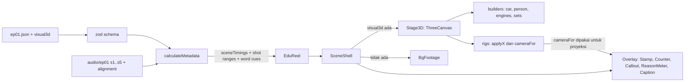

# EP01 3D Production: port previz ke domo-reels

Rencana teknis untuk memindahkan scene 3D dari `previz.html` ke project Remotion ini, memakai VO ElevenLabs yang sudah ada di `public/audio/ep01/`. Konsep kreatif ada di `CONCEPT.md`. Aturan di `CLAUDE.md` tetap berlaku penuh.

---

## 1. Kondisi sekarang

| Sudah ada | Belum ada |
|---|---|
| Template `EduReel` 5 beat, schema zod, `calculateMetadata` dari durasi VO | Paket 3D (`three`, `@remotion/three`, `@react-three/fiber`) |
| VO s1 s/d s5 + sidecar alignment per kata (`eleven_multilingual_v2`) | Folder `src/three/`, field `visual3d` di schema |
| Caption word by word, Stamp, Counter, BGM ducking, postprocess loudnorm | BGM dan SFX di `public/audio/bgm`, `public/audio/sfx` |
| `out/ep01.mp4` versi 2D | Git repo (folder ini belum `git init`) |

Durasi VO aktual: s1 3,44 dtk, s2 3,90, s3 8,54, s4 7,06, s5 4,09. Total komposisi sekitar 29,6 dtk.

## 2. Keputusan arsitektur

1. **Scene builder murni, terpisah dari React.** Fungsi `buildCar()`, `buildCarbEngine()` dan sejenisnya mengembalikan `THREE.Group` dan di-porting hampir 1:1 dari `previz.html`. Alasannya: logika geometri tetap bisa dites tanpa React, dan previz tetap jadi referensi visual yang sama persis.
2. **Animasi = fungsi waktu.** Setiap set punya `apply<Set>(rig, t, shot)` yang menyetel posisi dan rotasi dari `t = frame / fps`. Dilarang `useFrame` dengan clock, `Date.now()`, atau state antar frame, karena Remotion merender frame paralel di beberapa tab.
3. **Kamera dihitung oleh fungsi murni `cameraFor(shot, t)`.** Fungsi yang sama dipakai di dalam canvas dan di overlay 2D untuk memproyeksikan titik anchor label komponen ke layar. Satu sumber kebenaran, jadi label selalu menempel di komponen yang benar.
4. **Shot timing proporsional dan dikunci ke kata VO.** Panjang beat tetap dari VO (tidak berubah). Di dalam beat, shot dibagi dengan `share` (fraksi) dan cue penting dikunci ke kata VO lewat alignment (misalnya counter mulai di kata "tiga"). Kalau VO di-generate ulang, visual ikut menyesuaikan tanpa mengubah angka.
5. **Copy di JSON, anchor di kode.** Teks label (judul, sub) ada di `ep01.json`. Posisi 3D anchor didefinisikan di builder sebagai titik bernama (`"carb"`, `"injector"`, `"ecu"`, `"tempSensor"`), lalu JSON mereferensikan nama tersebut.
6. **Opt-in per scene.** Scene tanpa `visual3d` tetap memakai `BgFootage`. Ini jalur rollback paling sederhana.



## 3. Dependency

```bash
# Versi @remotion/three HARUS sama persis dengan remotion (4.0.541)
npm i -E @remotion/three@4.0.541
# Cek peer dependency sebelum memasang three dan fiber (perlu diverifikasi):
npm view @remotion/three@4.0.541 peerDependencies
# Pasang versi yang cocok dengan output di atas, contoh pola:
npm i -E three@<versi> @react-three/fiber@<versi yang mendukung React 19>
npm i -D -E @types/three@<versi sama dengan three>
npm audit
```

Previz memakai three r128 global. Di project, pakai import ES module (`import * as THREE from "three"`). Perbedaan API yang perlu disesuaikan saat porting dari r128 ke versi baru (perlu diverifikasi sesuai versi yang terpasang):

| r128 (previz) | Versi baru |
|---|---|
| `renderer.outputEncoding = THREE.sRGBEncoding` | `renderer.outputColorSpace = THREE.SRGBColorSpace` (diatur fiber secara default) |
| `texture.encoding = THREE.sRGBEncoding` | `texture.colorSpace = THREE.SRGBColorSpace` |
| Intensitas lampu non-physical | Lampu physically correct secara default, intensitas perlu dinaikkan atau `legacyLights` (tergantung versi) |

## 4. Struktur file baru

```
src/three/
├─ builders/
│  ├─ materials.ts      # std(), phys(), rbox(), tube(), cyl(), canvasTex()
│  ├─ car.ts            # buildCar(): body extrude, pintu, roda lathe, lampu, plat
│  ├─ person.ts         # buildPerson(): rig sendi, resetPose, walkPose
│  ├─ engineBay.ts      # bay + kap terbuka (dipakai dua mesin)
│  ├─ carbEngine.ts     # mesin karburator + jam 15 menit
│  ├─ injectionEngine.ts# mesin injeksi + injektor, spray, harness, sensor
│  ├─ dashboard.ts      # gauge canvas texture, jarum, setir, jalan
│  ├─ carport.ts        # carport + jalan + pohon + asap
│  └─ workshop.ts       # bengkel Doktermobil + lift
├─ rigs/
│  ├─ shots.ts          # tipe ShotId, shotRanges(), wordCueFrame()
│  ├─ camera.ts         # cameraFor(shot, t): posisi, target, fov (murni)
│  └─ animate.ts        # applyCarport/Vintage/Modern/Dash/Workshop(rig, t, shot)
├─ env.ts               # PMREM environment per set (dibuat sekali)
├─ anchors.ts           # titik 3D bernama untuk label komponen
└─ Stage3D.tsx          # <ThreeCanvas> + <primitive> + pemanggilan apply/camera
src/components/
├─ Callout.tsx          # titik + garis + kartu label, posisi dari proyeksi
├─ ReasonMeter.tsx      # meter tangki dan termometer
└─ WhipTransition.ts    # (opsional) presentation blur+zoom untuk TransitionSeries
```

## 5. Data contract: tambahan schema

Tambahkan field opsional `visual3d` ke `sceneBase` di `src/schema.ts`:

```ts
const shotId = z.enum(["hook", "myth", "inject", "walk", "drive", "fuel", "smoke", "temp", "cta"]);
const anchorId = z.enum(["carb", "choke", "injector", "ecu", "tempSensor"]);

const visual3dSchema = z.object({
  shots: z
    .array(z.object({ id: shotId, share: z.number().positive().max(1) }))
    .min(1)
    .refine((s) => Math.abs(s.reduce((a, x) => a + x.share, 0) - 1) < 1e-6, {
      message: "Shot shares in one scene must sum to 1",
    }),
  callouts: z
    .array(z.object({
      anchor: anchorId,
      title: z.string().min(1),
      sub: z.string().min(1),
      // Appears when this VO word starts (matched against the alignment).
      cueWord: z.string().min(1),
    }))
    .default([]),
  // Optional per-scene word cues (e.g. counter start).
  cues: z.record(z.string(), z.string()).default({}),
});
```

Contoh `ep01.json` (ringkas, copy dari `CONCEPT.md` bagian 6):

```json
{ "type": "fact", "...": "...",
  "visual3d": {
    "shots": [ { "id": "inject", "share": 0.36 }, { "id": "walk", "share": 0.27 }, { "id": "drive", "share": 0.37 } ],
    "callouts": [
      { "anchor": "injector", "title": "Injektor", "sub": "Semprot bensin presisi tiap siklus", "cueWord": "injeksi" },
      { "anchor": "ecu", "title": "ECU", "sub": "Atur campuran otomatis sejak mesin dingin", "cueWord": "sekarang" },
      { "anchor": "tempSensor", "title": "Sensor suhu", "sub": "Kasih tahu ECU kondisi mesin", "cueWord": "cukup" }
    ],
    "cues": { "counterStart": "tiga" }
  }
}
```

Usulan shot per beat untuk EP01:

| Beat | Shots (share) | Cue kata |
|---|---|---|
| hook | hook 1.0 | shake kepala di "Stop" |
| myth | myth 1.0 | label Karburator di "zaman", Choke di "karburator" |
| fact | inject 0.36, walk 0.27, drive 0.37 | label di "injeksi", "sekarang", "cukup"; counter di "tiga" |
| reasons | fuel 0.5, temp 0.5 | kartu 1 di "boros", kartu 2 di "Padahal" |
| cta | cta 1.0 | follow pill di "follow" |

## 6. Timing helpers (murni, wajib ada test)

```ts
// src/three/rigs/shots.ts
export type ShotRange = { id: ShotId; from: number; to: number }; // scene-relative frames

export const shotRanges = (shots: { id: ShotId; share: number }[], sceneFrames: number): ShotRange[] => {
  let cursor = 0;
  return shots.map((s, i) => {
    const to = i === shots.length - 1 ? sceneFrames : Math.round(cursor + s.share * sceneFrames);
    const range = { id: s.id, from: cursor, to };
    cursor = to;
    return range;
  });
};

// First frame of the first VO word that matches `word` (case and punctuation insensitive).
export const wordCueFrame = (words: { text: string; startFrame: number }[], word: string): number | undefined => {
  const norm = (w: string) => w.toLowerCase().replace(/[^\p{L}\p{N}]/gu, "");
  return words.find((w) => norm(w.text) === norm(word))?.startFrame;
};
```

Fallback jika `wordCueFrame` mengembalikan `undefined` (VO berubah dan kata cue hilang): pakai awal shot terkait, lalu `console.warn` dengan nama kata, mengikuti pola `loadWordTimings` yang sudah ada.

## 7. Stage3D (pola inti)

```tsx
// src/three/Stage3D.tsx (sketsa, nama props final mengikuti implementasi)
import { ThreeCanvas } from "@remotion/three";
import { useMemo } from "react";
import { useCurrentFrame, useVideoConfig } from "remotion";

export const Stage3D: React.FC<{ shots: ShotRange[] }> = ({ shots }) => {
  const frame = useCurrentFrame();
  const { width, height, fps } = useVideoConfig();
  const world = useMemo(() => buildWorld(), []);          // builders: sekali per tab
  const shot = activeShot(shots, frame);                   // shot aktif + waktu lokal
  applyShot(world, shot, frame / fps);                     // set visibility + pose, murni dari waktu
  const cam = cameraFor(shot, frame / fps);
  return (
    <ThreeCanvas width={width} height={height} shadows camera={{ fov: cam.fov, position: cam.position }}>
      <CameraSync cam={cam} />                             {/* set position, lookAt, fov tiap frame */}
      <primitive object={world.root} />
    </ThreeCanvas>
  );
};
```

Aturan:
- `buildWorld()` dan PMREM environment dibuat di `useMemo`, tidak pernah per frame.
- Canvas texture (gauge, jam, plat) digambar ulang setelah font siap: bungkus dengan `delayRender`, tunggu `document.fonts.ready`, redraw, lalu `continueRender`, atau `cancelRender(err)` saat gagal.
- Selama transisi 0,3 dtk, dua scene di-mount bersamaan (dua canvas). Ini normal, tapi jaga jumlah shadow map per set maksimal satu atau dua lampu.

## 8. Render dan performa

| Item | Langkah |
|---|---|
| WebGL saat render | Set renderer OpenGL di `remotion.config.ts`, misalnya `Config.setChromiumOpenGlRenderer("angle")` di Windows dengan GPU. Nama API dan nilai yang didukung **perlu diverifikasi** di docs Remotion (cari "gl" atau "OpenGL renderer"). |
| Concurrency | Mulai dengan `--concurrency=50%`. Naikkan hanya kalau GPU dan RAM aman. |
| Shadow map | 2048 hanya untuk matahari carport, 1024 untuk lainnya. |
| Pixel ratio | 1 saat render (output sudah 1080x1920). |
| Ukuran output | Target di bawah 30 MB. Cek dengan `ls -lh out/` dan `ffprobe -v error -show_entries format=duration,size out/ep01_final.mp4`. |
| Waktu render | Previz murni swiftshader (tanpa GPU) sekitar 1 dtk per frame. Dengan GPU lewat ANGLE seharusnya jauh lebih cepat. |

## 9. Opsi: tambah alasan "Nambah polusi"

Shot `smoke` (knalpot dan label gas CO, HC, NOx) sudah ada di kit. Untuk memakainya:

1. Ubah VO s4 di `ep01.json`, contoh: "Kelamaan idle bikin boros bensin, nambah polusi, dan mesin malah lebih cepat panas kalau dibawa jalan santai."
2. Tambah item reasons ketiga (schema mengizinkan maksimal 3).
3. `npm run tts -- ep01` (hanya s4 yang di-generate ulang karena `textHash` berubah).
4. Shots reasons: fuel 0.34, smoke 0.33, temp 0.33.
5. Cek total durasi tetap di bawah 30 dtk. Jika lewat, perpendek VO s3.

## 10. Test

| File | Yang dites |
|---|---|
| `tests/shots.test.ts` | `shotRanges` menutup seluruh scene tanpa celah atau overlap; share yang tidak berjumlah 1 ditolak schema |
| `tests/cues.test.ts` | `wordCueFrame` cocok tanpa peduli huruf besar dan tanda baca; kata yang tidak ada mengembalikan `undefined` |
| `tests/camera.test.ts` | `cameraFor` deterministik (t yang sama menghasilkan nilai sama); fov dalam rentang wajar |
| `tests/callout.test.ts` | Proyeksi anchor tiap callout berada di dalam frame dan kartu label di dalam `SAFE_AREA` |
| `tests/schema.test.ts` | Tambah kasus `visual3d` valid dan tidak valid |

```bash
npm test && npm run lint
```

## 11. Fase eksekusi dengan Claude Code

Jalankan per fase, review di Studio, baru lanjut. Di setiap prompt, minta Claude Code membaca `CLAUDE.md`, `docs/ep01-3d/CONCEPT.md`, `docs/ep01-3d/PRODUCTION.md`, dan `docs/ep01-3d/previz.html`.

**Fase 0: Repo dan dependency**
> `git init`, commit kondisi sekarang, buat branch `feat/3d-scenes`. Pasang dependency sesuai bagian 3 dengan versi yang cocok dari `npm view`. Jalankan `npm audit` dan laporkan hasilnya. Jangan ubah kode lain.

**Fase 1: Builders**
> Porting builder dari `previz.html` ke `src/three/builders/` dalam TypeScript (bagian 4). Pertahankan bentuk, ukuran, dan warna persis. Pindahkan angka warna ke konstanta bernama dalam file builder, dan warna brand diambil dari `src/lib/brand.ts`. Ganti API r128 sesuai tabel di bagian 3. Belum ada React.

**Fase 2: Rig dan kamera**
> Implementasikan `shots.ts`, `camera.ts`, dan `animate.ts` (bagian 2 dan 6) dari fungsi `renderAt` di previz. Semua fungsi murni dari waktu. Tambahkan test di bagian 10 untuk shots, cues, dan camera.

**Fase 3: Stage3D di composition**
> Buat `Stage3D.tsx` (bagian 7) dan sambungkan ke `SceneShell`: render `Stage3D` jika scene punya `visual3d`, jika tidak tetap `BgFootage`. Tambahkan `visual3d` ke schema dan ke `ep01.json` sesuai bagian 5. Hitung `shotRanges` dan cue frame di `calculateMetadata` lalu simpan di `sceneTimings`.

**Fase 4: Overlay penjelasan**
> Buat `Callout.tsx` (titik, garis, kartu; posisi dari proyeksi `cameraFor`), `ReasonMeter.tsx` (timer idle dan bar tangki, termometer 30 ke 90°C), lalu sambungkan cue kata ke Stamp, Counter, kartu alasan, dan pill follow. Semua teks dari JSON dan semua kartu di dalam `SAFE_AREA`.

**Fase 5: Render, QA, polish**
> Atur renderer OpenGL (bagian 8), `npm run render -- ep01`, lalu `npm run postprocess -- ep01`. Laporkan durasi, ukuran file, dan loudness. Opsional: presentation `WhipTransition` (blur dan zoom 0,3 dtk) menggantikan fade.

## 12. QA checklist

- [ ] Klaim di `CONCEPT.md` bagian 8 sudah di-approve teknisi
- [ ] Label komponen menempel di komponen yang benar sepanjang orbit kamera
- [ ] Caption dan label tidak saling menutupi, semua di dalam safe zone (cek di HP)
- [ ] Tidak ada flicker antar frame (render ulang 2 kali, hasil identik)
- [ ] Durasi di bawah 30 dtk, loudness sekitar -14 LUFS, ukuran di bawah 30 MB
- [ ] `npm test`, `npm run lint`, dan `gitleaks detect` bersih

## 13. Rollback

- Semua kerja di branch `feat/3d-scenes`; `main` tetap menghasilkan versi 2D.
- Hapus field `visual3d` dari satu scene untuk kembali ke `BgFootage` tanpa mengubah kode.
- `out/ep01.mp4` versi 2D jangan ditimpa: render 3D ke `out/ep01-3d.mp4` sampai lolos QA.

## 14. Definition of done

Jalan benar dan sinkron dengan VO ✔ deterministik ✔ teks di safe zone ✔ test lulus ✔ ukuran dan loudness dicek ✔ klaim di-review teknisi ✔ bisa dijelaskan sendiri (kenapa kamera murni, kenapa cue berbasis kata) ✔
